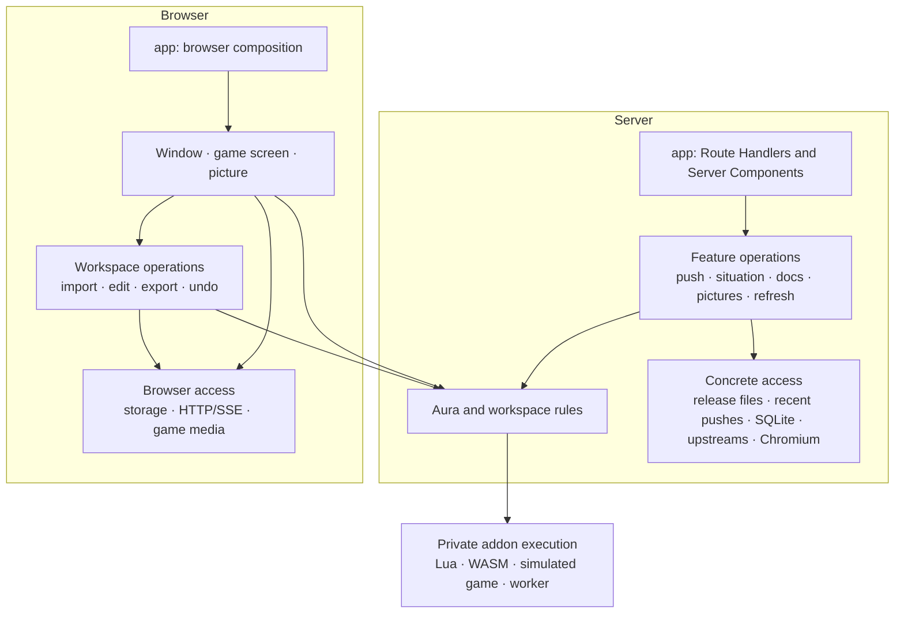

| Layer / module under `src/` | Owns; public interface | Behind the interface | Callers |
|---|---|---|---|
| Framework: `app/` | Routes, metadata, streaming, page composition | HTTP parsing/responses; assembling the editor and standalone picture pages | Next.js |
| Composition: `server/composition.ts` | Construct concrete dependencies for each game | Environment, paths, fixtures, process lifetimes | Server entry points |
| Presentation: `window/` | Window, aura list, tabs, dialogs, import/export controls; `<Window>` | Components, styles, option drafts, keyboard interaction | Browser composition |
| Presentation: `game-screen/` | Drawing auras; `<GameScreen>`, `<GameScreenAuras>`, `evaluateScreen` | Layout, displays, display elements, animations, pixel grid | Editor and pictures |
| Browser operations: `workspaces/browser/` | Open workspace, select/create/change/import/export auras, undo/redo; `useWorkspace` | Commit rules, history, edit ordering, original representations, storage and connection | Window, page scripting |
| Server operations: `workspaces/server/` | `pushAura`, `setSituation`, `readRecentPushes`, `followWorkspace`, `forgetWorkspace` | Bounded recent pushes, stream identity, revisions, mutation ordering | HTTP routes, pictures |
| Portable rules: `workspaces/model.ts` | Workspace and group changes, placement, file format | Unique ids, parent/children consistency, restoration decisions | Browser/server operations, drawing |
| Server operation: `agent-docs/` | `buildAgentDocs({game, ref, topic})` | Release-specific facts, topic writers, examples, table-map presentation | Markdown routes, HTML docs |
| Server/browser: `pictures/` | `loadPicture`, `takePicture`, `compareScreenshot`, font samples; `<AuraPicture>` | Chromium, capture queue, readiness/crop, image decoding and comparison mathematics | Picture routes/pages |
| Server/browser access: `addon-releases/` | List/resolve releases, read files/bundles, load an addon, compare releases | Musca tags, WeakAuras release zips, immutable caches, loaded-addon lifetimes | Workspace operations, docs, pictures, version picker |
| Server/browser access: `catalogs/spells/` | Search, lookup, refresh, status; browser search access | Spell tables, ranking, Wowhead enrichment, SQLite | Routes, spell picker, simulated game |
| Server access: `catalogs/items/` | Search, lookup, refresh, status | Item tables, icon matching, SQLite | Routes |
| Portable/server/browser: `catalogs/game-files/` | Path identity, file/icon lookup, refresh; texture/font loading | Manifest, SQLite, BLP/TGA decoding, browser byte/image caches | Routes, drawing, pictures, other catalogs |
| Server operation: `catalogs/textures/` | Find similar icons/textures, indexing status | Appearance features, indexing, retries, SQLite | Search routes; file-refresh operation |
| Portable descriptions: `games/` | `GameId`, game descriptions, `findGame` | Two plain records | Composition and domain modules |
| Shared primitives: `ui/`, `lib/` | Generic UI and proven technical primitives | No product decisions | Relevant modules |

The table names **modules and capabilities**, not mandatory files for every method. A module gets a public entry point and private implementation files as its size warrants.

**The architecture follows the framework’s execution model and groups code by business responsibility.**

Research checked Next.js **16.4.5** and React **19.3.0**. This worktree has no `node_modules`; the matching installed documentation was read from the main checkout, including all six requested Next.js guides. Live research covered official documentation, working repository source, authors’ articles and conference material.

| Evidence | Convention and consequence |
|---|---|
| [Next.js project structure](https://nextjs.org/docs/app/getting-started/project-structure) | Next prescribes routing files, while explicitly allowing several application layouts. Colocation inside `app` and feature folders outside it are both supported. Keeping this project’s `app` thin is our convention. |
| [Route Handlers](https://nextjs.org/docs/app/getting-started/route-handlers), [backend for frontend](https://nextjs.org/docs/app/guides/backend-for-frontend) | Route Handlers provide public HTTP interfaces, including streams, files and images. Server Components should call server modules directly; calling the application’s own HTTP routes adds a round trip and can fail during prerendering. |
| [Data security](https://nextjs.org/docs/app/guides/data-security), [Sebastian Markbåge’s security article](https://nextjs.org/blog/security-nextjs-server-components-actions) | An internal server-only data-access layer suits applications owning their backend. Validate entry values and return deliberate results. This does not prescribe repository classes or a universal `data/` directory. |
| [Server Actions](https://nextjs.org/docs/app/guides/server-actions), [Lee Robinson on building APIs](https://nextjs.org/blog/building-apis-with-nextjs) | Actions suit frontend mutations; Route Handlers suit public protocols and other clients. Both can call the same underlying operation. Actions are dispatched sequentially per browser client. |
| [Next server/client composition](https://nextjs.org/docs/app/getting-started/server-and-client-components), [React’s directives](https://react.dev/reference/rsc/directives) | `'use client'` defines a transitive import graph. Client components also participate in server prerendering. `'use server'` exposes Server Functions; it does not mark ordinary server modules. |
| [React custom hooks](https://react.dev/learn/reusing-logic-with-custom-hooks), [external-store subscriptions](https://react.dev/reference/react/useSyncExternalStore) | Hooks integrate React with state and external systems. Ordinary functions own calculations; an existing workspace store can expose stable snapshots through `useSyncExternalStore`. |

The inspected codebases show different choices at different scales:

| Codebase | Actual organization | What to borrow |
|---|---|---|
| **Vercel Shop** | [Domain conventions](https://github.com/vercel/shop/blob/main/AGENTS.md); [product caching](https://github.com/vercel/shop/blob/main/lib/product/server.ts) separated from upstream operations | Domain ownership followed by execution context; distinguish cached access from underlying work. |
| **Vercel next-forge** | Route-local components and small actions; integration packages with explicit [`server-only`](https://github.com/vercel/next-forge/blob/main/packages/database/index.ts) entries | Concrete functions and runtime protection. Its simple operations do not require a separate service layer. |
| **Dub** | [Routes](https://github.com/dubinc/dub.link/blob/main/apps/web/app/api/links/route.ts) call substantive [link operations](https://github.com/dubinc/dub.link/blob/main/apps/web/lib/api/links/create-link.ts); domain UI and browser-fetching hooks live separately | Extract an operation when it owns meaningful sequencing and reuse. |
| **Cal.diy** | [Feature packages](https://github.com/calcom/cal.diy/tree/main/packages/features/bookings), substantial services/repositories, and concrete [import restrictions](https://github.com/calcom/cal.diy/blob/main/biome.json) | Enforce direction mechanically. Its monorepo and DI machinery reflect a larger application. |

These examples agree on recognizable ownership and runtime separation. They disagree on how much work belongs directly in pages/actions and how many internal layers justify extraction. None establishes a compulsory controller → service → repository chain.

[TkDodo’s vertical codebase](https://tkdodo.eu/blog/the-vertical-codebase), [Kent C. Dodds on colocation](https://kentcdodds.com/blog/colocation), and [Matt Pocock on deep modules](https://www.aihero.dev/how-to-make-codebases-ai-agents-love) support keeping related implementation together behind a small interface. Dan Abramov’s [React Conf talk](https://conf2024.react.dev/talks/6), [accompanying notes](https://overreacted.io/react-for-two-computers/) and [RSC import explanation](https://overreacted.io/how-imports-work-in-rsc/) explain why execution context must remain explicit within that organization.

**Chosen conventions.** Use business modules with portable, server and browser entry points only where needed. Private hooks, styles, parsers and tests stay beside their owner. `app` contains framework entry points and composition. Plain functions and stateful objects are sufficient.

Retain Route Handlers for the agent protocol, browser HTTP access, SSE, downloads and images. The browser owns workspace editing; Server Actions add no useful capability to those local mutations today. Server-rendered docs, font and picture pages call their server operations directly.

Keep the persistent Node deployment: SQLite, recent pushes, background work and Chromium already depend on it. The framework’s [deployment caveats](https://nextjs.org/docs/app/guides/backend-for-frontend#deployment-environment) explain why this design cannot simply be deployed as isolated lambda invocations.

**The deepest seams contain the rules callers must never reconstruct.**

Applying `codebase-design` and `DEEPENING.md` gives these ownership decisions:

- **`auras` owns aura meaning and addon behaviour.** Its interface exposes aura documents, import acceptance, encoding, defaults, diagnostics, options, new auras, typed addon facts, the table map and situation evaluation. Lua, contracts, simulated game answers, spell preloading, serialization bridges and worker messages remain private. Keep the open Lua-table document model; validate structured addon answers once before exposing them.
- **`workspaces/browser` owns accepted workspace changes.** Window controls invoke operations; they cannot replace arbitrary snapshots. One commit updates the workspace and history together, including an empty workspace. Option drafts remain in the tabs; serialization and acceptance of edits belong to workspace operations.
- **`workspaces/server` owns push acceptance and publication.** Its interface exposes operations and read/subscription results. Raw `set` methods on the recent-push storage stay private.
- **`addon-releases` owns obtaining and keeping an addon at a release.** Resolve a requested release once. File reads, loaded addons and derived caches subsequently accept that resolved value. Disk paths and generic `memo` methods are private.
- **Each catalog is a concrete deep module.** Refresh and search policy sit above private downloading, interpretation and SQL. Tests can exercise the module with recorded HTTP answers and real SQLite.
- **`pictures` owns the complete picture/comparison workflow.** Its callers know picture settings and results, not browser pools, DOM selectors or image-library objects.

These interfaces include lifetime and failure rules:

1. **Edits carry their source.** Capture game, workspace, addon lifetime, originating aura/top-level aura and document generation when the edit starts. Completion checks that source. Changing selection cannot redirect it; a newer push or undo invalidates an older edit.
2. **Disposal settles pending work.** Addon disposal rejects outstanding requests and prevents later completions from committing. Prepared storage writes contain immutable serialized content, so they cannot subsequently read a different selection or disposed addon.
3. **Imported representation belongs to the aura.** Preserve the original state code and wago representation/metadata while its content is unchanged. Defaults used for editing or drawing do not silently rewrite that original.
4. **Import acceptance has one implementation.** Paste, files, JSON Apply, pushes and `auraSimulator.load` all reach the same addon decision. A workspace-file replacement checks every contained aura before committing.
5. **Local commit, browser saving and server publication have distinct outcomes.** A network failure leaves the accepted local edit visible and reports failed publication. There is no distributed transaction spanning the browser and server.
6. **Preview and drawing consume the same aura evaluation.** Text replacement, conditions and unevaluated custom Lua are determined there. Presentation does not restate those rules.

**The use cases have these call paths.**

Each arrow below is a meaningful call or runtime crossing. Private parsing and mathematical helpers are omitted; branches do not imply forwarding modules.

| Use case | Path |
|---|---|
| Push an aura | HTTP route → `pushAura` → release resolution/loading and optional Wago retrieval → `auras` import acceptance, diagnostics and preview → private recent-push commit → notices |
| Set the situation | HTTP route → `setSituation` → parse situation through `auras` → evaluate the latest committed aura → commit situation and notice |
| Build agent docs | Route or Server Component → `buildAgentDocs` → resolved release → cached addon facts/table map → selected game’s topic writer |
| Take a picture | HTTP route → `takePicture` → select committed aura/release/situation → Chromium capture → picture page → `loadPicture` → `<AuraPicture>` → game-screen drawing |
| Compare | HTTP route → `compareScreenshot` → select source once → direct `takePicture` calls at required scales → comparison mathematics and image encoding |
| Refresh spells | Route → `spells.refresh` → download one selected build → interpret spell tables → transactional SQLite replacement |
| Refresh items | Existing refresh/first-use trigger → `items.refresh` → download one build → interpret item tables → transactional replacement |
| Refresh files | Existing refresh/first-use trigger → `refreshGameFiles` → file-catalog refresh → schedule texture indexing after success |
| Search similar textures | Route → texture-search operation → file/addon texture access and appearance catalog → ranking |
| Edit an option | Control → workspace `editOption(source, address, value)` → addon `setOption` → guarded workspace commit |
| Import | Import control, dropped file or page script → workspace import operation → optional Wago HTTP retrieval → shared addon import acceptance → commit |
| Export | Window → workspace export operation → preserved aura representation or workspace serializer → returned file/clipboard contents |
| Undo/redo | Window command → workspace history → workspace commit → saving/publication |

Pushes, situation changes and forgetting a workspace are ordered per workspace. Required preparation finishes before committing. Expected aura problems are returned as diagnostics; an operational failure before acceptance leaves the previous state intact. Notice delivery cannot turn an accepted mutation into an ordinary failure.

Stream identity is separate from retained pushes. Notices and fetched revisions identify their epoch; deletion, eviction and restart cannot masquerade as older events. The browser resynchronizes when its requested revision is unavailable.

Pictures pin the aura revision, situation and resolved addon release. Every comparison scale uses that source. Losing the retained revision produces an explicit failure instead of drawing a newer aura. Only identifiers and picture settings enter the address.

Chromium navigating the picture page is an intentional runtime crossing. Server Components themselves never fetch the screenshot or workspace HTTP endpoints.

For addon execution, retain only the indirections doing work:

```text
Node:     operation → aura method → inline addon → runLua
Browser:  operation → aura method → worker request → addon → runLua
```

Spell preparation and Lua-stack restoration remain. The server does not need the current asynchronous Proxy/dispatch envelope around an already local addon.

**Interfaces remain where there is actual variation.**

| Seam | Real variation | Decision |
|---|---|---|
| Game behaviour | Forever and TBC rules, simulated game answers and addon requirements | Plain game descriptions; private per-game implementations in `auras`. Keep shared behaviour only under the existing mirrored-file evidence. |
| Addon release files | Musca repository tags; WeakAuras release zips | Keep a narrow release-file interface. Remove generic derived-cache operations from it. |
| Addon inputs | Browser bundles/HTTP versus server cached files; browser versus server spell answers | Inject the few required functions into addon loading. No application-wide environment interface. |
| Addon execution | Worker and inline execution | Keep this internal seam, with identical results and terminal disposal semantics. |
| Workspace storage | IndexedDB and the existing localStorage fallback | Keep a private read/write seam. Write-behind ordering is concrete workspace behaviour above it. |
| External upstreams | Live GitHub/jsDelivr/Wago/Wowhead versus recorded answers | Inject HTTP at the access module; ordinary tests supply fixtures. |
| Drawing media | Selected game/release resources versus deterministic recorded resources | Supply texture/icon/font access at composition. Missing provision fails explicitly; no Forever fallback. |

SQLite does not need a repository interface: tests use the same implementation with an in-memory database. Recent pushes have one in-memory implementation; keep a concrete module with fresh instances for tests.

Remove the standalone abstractions around `ReferenceSource`, generic `History<T>`, `newerWorkspace<T>`, `queued<T>` and `tracked<A,R>`. Their concrete behaviour remains with its owner. `WorkspaceStore` is private write-behind implementation, not a public storage-provider family.

Remove `ServerGame` because it combines unrelated capabilities. Composition passes each operation the dependencies it actually uses. Its two game instances do not make that aggregate a useful interface.

Keep the shared IndexedDB transaction primitive and drawing time/pixel scopes: each protects one repeated lifetime or coordinate invariant. That is a specific justification under “1, 2, many”, rather than a numerical exception applied indiscriminately.

**The moves establish ownership without adding forwarding layers.**

| Current files | Destination and structural change |
|---|---|
| `core/**` | `auras/**`. Addon execution becomes private; simulated game implementations remain distinct. Public exports describe aura capabilities. |
| `workspace/tree.ts`, `workspace.ts`, `restore.ts`, `files.ts` | Portable `workspaces` rules and file format. History becomes concrete workspace history. |
| `client/workspace/**`, `client/situation.ts` | `workspaces/browser/**`. Consolidate commits/history; retain storage and connection as private implementation. |
| `server/workspaces/push.ts`, `situation.ts`, `hub.ts` | `workspaces/server/**`. HTTP body handling moves to the transport edge; storage mutation becomes private. |
| `games/server.ts`, `<game>/server.ts`, `server/game.ts` | Explicit server composition. Delete `agentDocs` callbacks and `createClientCaches`; remove infrastructure imports from game descriptions. |
| `server/addon/**`, `client/addon-client.ts`, `app/addon/**` | `addon-releases/**`; version-picker presentation moves to `window`. Keep immutable file caching together; resolve once. |
| `server/spells/**`, `items/**`, `game-files/**` | Three concrete catalog modules. Extract only shared product/build metadata, atomic replacement and in-flight refresh policy, plus demonstrated common parsing/normalization. |
| `server/icon-index/**` | `catalogs/textures/**`. Cross-catalog refresh sequencing lives in `catalogs/refresh-files.ts`, above both modules. |
| `render/textures` decoding/path rules and transport | Game-file identity/decoding and browser access move to `catalogs/game-files`. React drawing and resource consumption remain in `game-screen`. |
| `render/**`, `app/screen/**` | `game-screen/**`. Extract model-placeholder and stop-motion drawing below full displays and display elements, removing their cycle. |
| `server/screenshot.ts`, `server/compare/**`, `server/workspaces/render.ts`, `client/render/**`, `app/render/**`, font samples | `pictures/**`. Keep capture, comparison and crop/readiness behind its public interface. |
| `games/*/docs/**`, `games/docs/**`, `server/option-reference.ts` | `agent-docs/**` topic writing and server preparation. Table-map generation remains inside `auras`; release-keyed persistence belongs to release access. |
| `app/NewAuraChooser`, `SituationControls`, validation/import-export/JSON features; corresponding `components/**` | `window/**`. Private hooks/styles move with their feature. Generic controls become `ui/**`. |
| `api/**` | Contracts beside their owning feature. Domain rules leave HTTP contract files. Delete the ownerless directory. |

Delete single-file forwarding barrels, unused upcoming-game machinery and dead Lua. Keep deliberate public entry points such as `auras/index.ts`; their purpose is to hide implementation.

The older review’s `WindowField*` vocabulary is superseded. Keep **option**, use **table map**, and let workspaces hold **auras** and groups hold **children**. Other proposed symbol and URL names remain vocabulary proposals for step 04.

**Dependency direction is checked on resolved imports.**

Run ESLint and [dependency-cruiser](https://github.com/sverweij/dependency-cruiser) together through `npm run lint`. Use the TypeScript configuration for resolution and include type dependencies. Check the runtime graph separately so erased type edges are not misreported as runtime cycles. Its [configuration](https://github.com/sverweij/dependency-cruiser/blob/main/doc/options-reference.md) supports these distinctions and a shrinking baseline.

Enforce these rules:

- Nothing imports `app` or composition from below.
- `games` contains descriptions and imports no feature implementation.
- Portable aura/workspace rules import no React, Next, browser storage, HTTP implementation or database.
- Server access imports domain types and lower access modules; never operations or presentation.
- Browser operations import portable rules and browser access; never server implementation.
- `window` may use workspace operations and drawing. Drawing imports portable rules and its media interface; never workspace operations, concrete games or HTTP clients.
- Pictures may read recent pushes; workspaces never import pictures.
- Docs may consume feature contracts and addon facts; other features never import docs.
- Cross-module imports use declared entry points. Internal imports stay internal; changing alias spelling to a relative path grants no exception.
- Node-only entries import `server-only`. Pure entries never re-export server entries. Client initialization waits for browser lifetime, with stable server snapshots.
- Both module dependency cycles and runtime file cycles fail lint.

Dependencies supplied at composition are concrete I/O adapters, not callbacks into higher application operations. No DI container is needed.

**Step 03 proceeds in these green slices.**

Prerequisite: steps 01 and 02 have delivered trustworthy fixtures and behavioural regressions. Step 03 preserves those behaviours, existing public spellings, routes and stored formats.

1. **Install direction checks with a frozen baseline.** New violations fail immediately; every subsequent slice removes its entries.
2. **Separate pure game descriptions and server composition.** Move environment/fixture selection and construction first. Existing callers continue using the same concrete capabilities.
3. **Establish the `auras` seam.** Move addon implementation behind it and remove external private imports. Preserve callable behaviour; typing and final surface cleanup finish in step 05.
4. **Consolidate server workspace operations.** Separate HTTP translation from push/situation work; hide recent-push mutation and retain the step-02 ordering/epoch guarantees.
5. **Move browser workspace ownership and the window.** Put commits/history together, move feature code out of `app`, and make React subscribe to the workspace.
6. **Separate drawing from media access.** Move decoding and HTTP/cache access, require supplied game resources, and remove the display/display-element cycle.
7. **Move catalogs, pictures and docs to their owners.** Keep SQL/upstream changes separate from drawing changes. Extract only necessary sequencing during this step.
8. **Close the baseline.** Check public imports, both dependency graphs, release propagation and every listed use case. Any remaining exception names its reason and removal ticket.

Each slice passes typecheck, lint and `npm run test:all`, then integrates before the next. Replace tests of absorbed private machinery once equivalent public behaviour is covered; retain mathematical contracts, golden fixtures, exhaustive accounting and deterministic pictures.

Step 04 completes vocabulary and deliberately drops old workspace formats. Step 05 removes remaining unearned machinery and finishes addon-result typing. Step 06 turns each game’s docs into a short front index and topic files, preserving the resolved release in every link.

No repository files were changed.